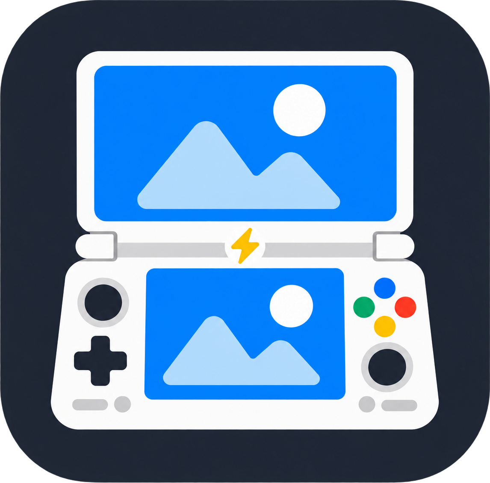
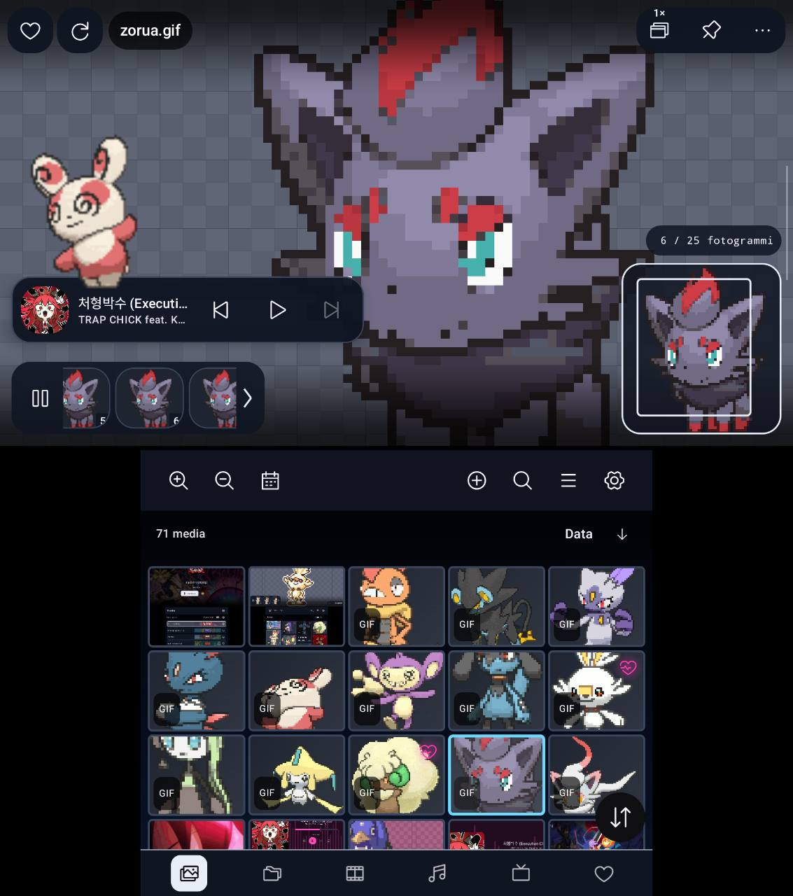
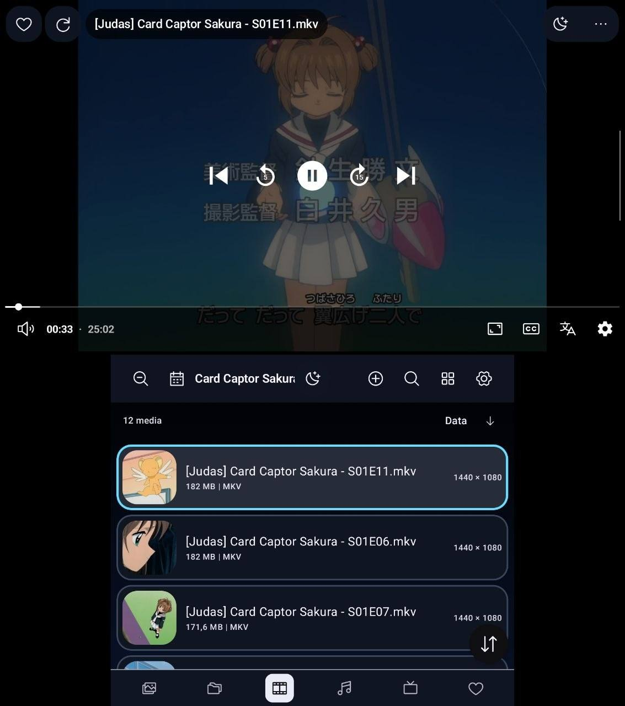
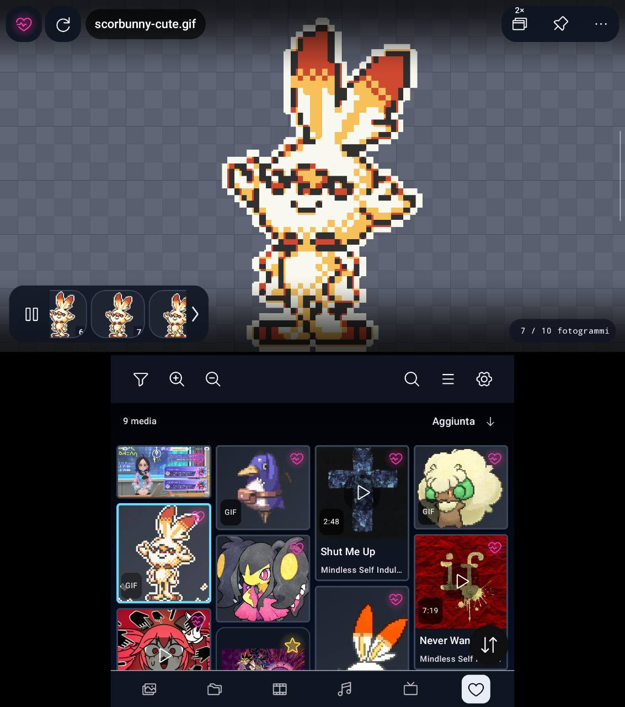
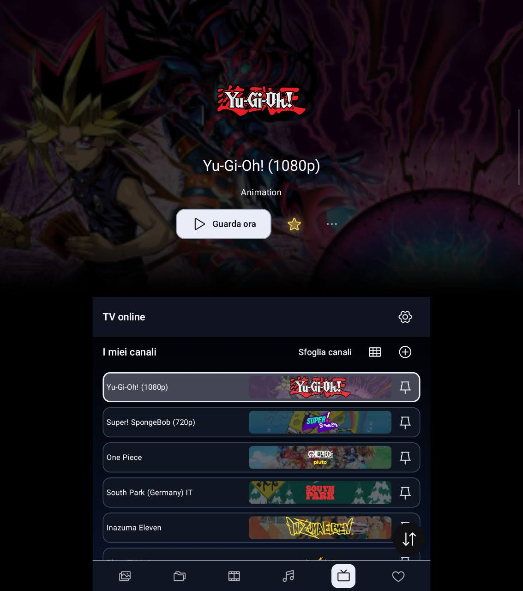
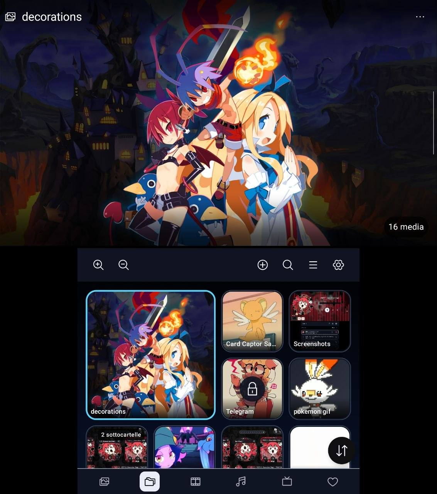
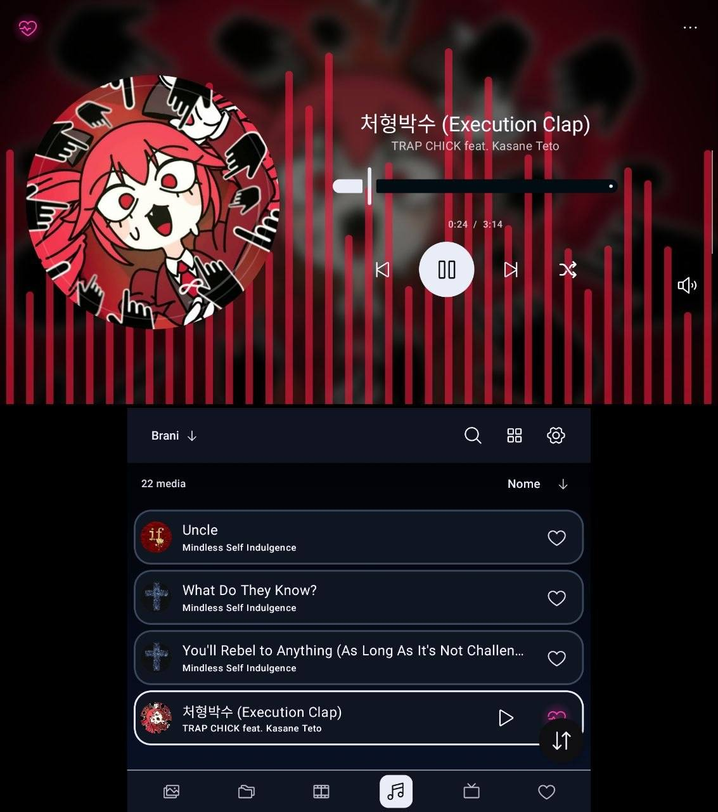
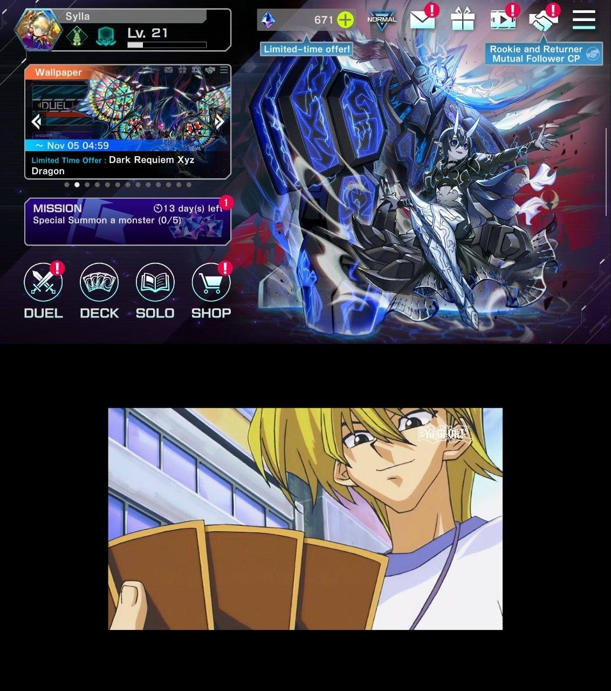
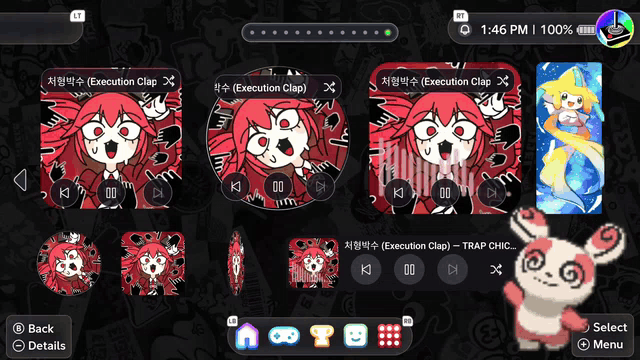

<p align="center"></p>
<h1 align="center">DS Gallery (DualScreen Gallery)</h1>
<p align="center">Your media. Two screens. One gallery.</p>
<p align="center"><strong>Android · Kotlin · Jetpack Compose · AYN Thor</strong><br />Public beta · Created by Syllabuss</p>
<p align="center"><a href="https://github.com/Syllabuss/DualScreen-Gallery/releases">Downloads</a> · <a href="docs/USER_GUIDE.md">User guide</a> · <a href="https://ko-fi.com/syllabuss">♥ Support on Ko-fi</a></p>

DS Gallery started as something I was making for myself. I wanted to choose exactly which folders became albums, rather than hide half my device after every scan. I also wanted a gallery that actually used both screens of my AYN Thor. I tried other apps, but none quite worked the way I wanted.

The players grew out of the same idea: separate volume controls for music and video, audio and subtitle tracks within reach, and the freedom to keep something playing in a floating window while looking through the rest of my library. I wanted those tools available without needing every button on screen all the time. You can keep the interface light, or show more controls and make use of the controller shortcuts.

What began as a small gallery became a media manager I enjoy using. I thought the result was worth sharing, in case it fits someone else's handheld too. It was designed and developed on the **AYN Thor**; I don't own other dual-screen Android devices, so I haven't been able to test them. Android 9 or later is required, and single-screen mode is still experimental.

<a name="see-it-in-use"></a>

## See it in use (Y swaps the screens)

**Ⓨ Swap screens** — the preview and browser can trade places; Y is the default, and you can remap it in Controls. Most captures below show the preview above the browser. Open any screenshot to see it at full size. The media shown comes from my own library and isn't included with the app.

<p align="center"><a href="https://www.youtube.com/shorts/u7ObFoqf3pA"><strong>▶ Watch the showcase on YouTube</strong></a></p>

<table>
  <tr>
    <td align="center" width="50%"><strong>Photos &amp; GIFs</strong><br /><br /><a href="assets/showcase/photos-gif-dual-screen.jpg"></a><br /><sub>Inspect a frame, zoom in, and keep your music nearby.</sub></td>
    <td align="center" width="50%"><strong>Video player</strong><br /><br /><a href="assets/showcase/video-dual-screen.jpg"></a><br /><sub>Playback on one screen, your files on the other.</sub></td>
  </tr>
  <tr>
    <td align="center"><strong>Favorites</strong><br /><br /><a href="assets/showcase/favorites-dual-screen.jpg"></a><br /><sub>Images, GIFs, music and videos in one place.</sub></td>
    <td align="center"><strong>Online TV</strong><br /><br /><a href="assets/showcase/online-tv-dual-screen.jpg"></a><br /><sub>A player for channels and playlists you add yourself.</sub></td>
  </tr>
  <tr>
    <td align="center"><strong>Albums</strong><br /><br /><a href="assets/showcase/albums-dual-screen.jpg"></a><br /><sub>Your folders, covers and album layout.</sub></td>
    <td align="center"><strong>Music player</strong><br /><br /><a href="assets/showcase/music-dual-screen.jpg"></a><br /><sub>A player on one screen, your music library on the other.</sub></td>
  </tr>
</table>

### Keep a screen for your game

Here, a game uses the upper display while DS Gallery plays a video on the lower one.

<p align="center"><a href="assets/showcase/gaming-and-video-dual-screen.jpg"></a><br /><sub>Game above, DS Gallery below.</sub></p>

### Home-screen widgets

<p align="center"><a href="assets/showcase/widgets-iisu.gif"></a><br /><sub>Widgets in different sizes and playback styles, shown on iiSU.</sub></p>

The launcher, wallpaper and desktop decorations in this recording are separate from DS Gallery. The widget choices are **Icon Player**, **Compact Player** and **Photo frame**; a small music widget is the Compact Player resized to 1×1.

## A gallery built around your folders

- **Choose your library.** Add one or more root folders. Their subfolders appear directly as albums; music uses its own roots. No automatic device-wide discovery.
- **Keep your layout.** Each section and individual album remembers its own list/grid view and thumbnail size. Timeline grouping, favorites, search and individual toolbar visibility help you browse your way.
- **Enjoy the preview.** Photos support pinch zoom, controller zoom/pan, smooth swiping and temporary 90° rotation. Pin a preview while browsing, open up to two comparison images, or inspect GIF frames with the expandable filmstrip. Optional nearest-neighbor rendering keeps pixel-art edges sharp.
- **Work across your network.** Settings → Tools combines the trash, experimental duplicate finder and network files. Share a chosen Thor folder over FTP, or browse FTP/SMB shares with guided connection recovery and copy/move controls. Network access never adds folders to your gallery automatically.
- **Listen while browsing.** Separate in-app music and video volume controls, background music playback, notification controls, shuffle/repeat, animated cover styles and theme, cover-derived or custom colors. Compact controls remain available beside image previews.
- **Make it yours.** Light, dark, neon and pastel palettes, a custom color picker and ten interface languages.
- **Manage media carefully.** Guided copy/move destinations, a seven-day trash, collections and editors that save new copies. PIN album locks control access inside the gallery; they do not encrypt files.
- **Watch on either screen.** Choose audio and subtitle tracks, resume recent videos, seek with progressive stick or double-tap controls, dim the other display, and continue in Android picture-in-picture.
- **Start comfortably.** An eight-page tutorial covers language, theme, controller shortcuts, images, videos, gestures and folder linking. L1/R1 move through the pages; the other display shows a multilingual welcome.
- **Add home widgets.** Icon Player (2×2) and Compact Player (3×1, or resize to 1×1 for a one-tap play/pause cover), plus one resizable photo widget for a single image/GIF or an album slideshow.

## Get started

Optional online TV supports user-supplied HTTPS M3U playlists, a personal channel list and live playback through the existing video/PiP coordinator. It starts disabled. See the [TV guide](docs/TV.md) for setup and limits; online TV is experimental.

1. Download the APK from the **[Releases](https://github.com/Syllabuss/DualScreen-Gallery/releases)** page.
2. Install it on Android 9 or later. Existing installations should be updated in place; do not uninstall to update.
3. Open the gallery and choose a folder containing photos or videos. Add music folders separately in **Settings → Info and permissions**.
4. On Thor, check **Open on two screens at startup** in Screens and backup. A opens, B navigates back, X opens contextual options, Y swaps the panels, L3 opens PhotoFrame and R3 changes the view. The tutorial shows the current controller mappings.

See the [user guide](docs/USER_GUIDE.md) for folders, controller controls, widgets and editing, and [permissions & privacy](docs/PRIVACY.md) for why access is requested.

For an Italian introduction, see [Leggimi in italiano](docs/README.it.md).

## Development

Use **JDK 17**, Android SDK **35** and the included Gradle wrapper. Builds and unit tests run on a standard Android development environment. A physical Thor is needed to validate two-display behavior.

```sh
bash ./gradlew :app:testDebugUnitTest :app:lintDebug :app:assembleDebug
```

On Windows:

```powershell
.\build-apk.ps1 -JavaHome 'C:\path\to\jdk-17'
```

The [development guide](docs/DEVELOPMENT.md) covers project structure, test fixtures, screenshots and device checks. [Contributing](CONTRIBUTING.md), [localization](localization/README.md) and [release procedures](docs/RELEASING.md) are documented separately.

## Distribution and source terms

First-party source is [GPL-3.0-only](LICENSE.md); branding and third-party assets have separate terms. APK distributions must include the matching [LGPL reconstruction kit](docs/LGPL_RELINKING.md), so recipients can replace the MP3 library and rebuild without maintainer signing keys. Online TV includes no catalogs or channels, requires first-use acknowledgement and grants no broadcast rights; see [authorized sources and reporting](docs/TV_RIGHTS.md).
